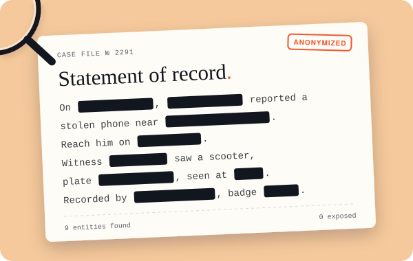

  

  <a href="https://www.linkedin.com/in/shreyanshsachan11/">LinkedIn</a> ·
  <a href="https://leetcode.com/u/ShreYanshSachan/">LeetCode</a> ·
  <a href="https://www.codechef.com/users/shreyansh1407">CodeChef</a> ·
  <a href="https://www.instagram.com/l.shreyansh.l/">Instagram</a> ·
  <a href="mailto:shreyanshsachan2016@gmail.com">Email</a>

### Hi, I'm Shreyansh

I build fast, thoughtful React products. Right now that's real-time promotions at **Pinntag**, and I have a soft spot for AI, RAG pipelines and the occasional "what if?"

- 🏆 **1st place, Karnataka State Police Datathon**, out of 1,100+ teams
- 🧩 **500+ DSA problems** solved on LeetCode and CodeChef
- 🎓 B.Tech in Computer Science (Data Science), AKGEC, 2025

### Things I've built

<table>
  <tr>
    <td width="50%" valign="top">
      
      <h4>Sherlock · data privacy for law enforcement</h4>
      
Finds and anonymizes personal data in records with SpaCy, Tesseract, Presidio and LLMs. Cut task completion time by 80%.

      
<a href="https://sherlock-rose.vercel.app/">Live</a> · <a href="https://github.com/ShreYansHSachan11/KSP_Project-Sherlock">Code</a>

    </td>
    <td width="50%" valign="top">
      
      <h4>NextHire · AI-powered job portal</h4>
      
Semantic search and recommendations with ChromaDB and OpenAI, plus AI resume parsing that cut screening time by 40%.

      
<a href="https://next-hire-kappa.vercel.app/">Live</a> · <a href="https://github.com/ShreYansHSachan11/NextHire">Code</a>

    </td>
  </tr>
  <tr>
    <td width="50%" valign="top">
      
      <h4>Guardian · disaster management</h4>
      
Real-time updates over WebSockets and transparent crowdfunding with Solidity, IPFS and MetaMask.

      
<a href="https://github.com/ShreYansHSachan11/GUARDIAN">Code</a>

    </td>
    <td width="50%" valign="top">
      
      <h4>FAQ Manager · multilingual FAQs</h4>
      
Automatic translation via the Google Translate API, with Redis caching that cut database queries by 50%.

      
<a href="https://faqfrontend-shreyanshsachan11s-projects.vercel.app/">Live</a> · <a href="https://github.com/ShreYansHSachan11/FAQbackend">Code</a>

    </td>
  </tr>
</table>

### Toolkit

**Languages:** C++ · JavaScript · Python  
**Web:** React.js · Redux · Node.js · Express.js · FastAPI · Redis · Socket.io · REST · JWT · OAuth  
**Data:** MySQL · MongoDB · Firebase · FAISS / ChromaDB  
**AI:** OpenAI API · RAG pipelines

The artwork is animated SVG generated from my portfolio's design system.
